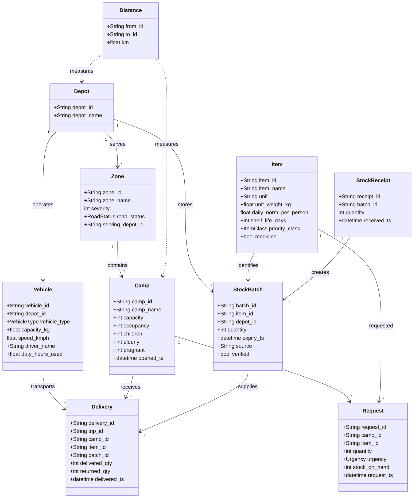

# T029 – Disaster Relief Resource Allocation and Priority Dispatch Engine

**Team:** T029

**Problem Statement:** PS-100

**Technology:** Python 3.10+

**Design Phase:** Week 1 – Understand and Design

---

# 1. Project Overview

## 1.1 Problem Statement

During disasters like floods or earthquakes relief items must be shared quickly with the zones that are hit and with relief camps.

Because stock is limited disaster intensity changes roads can be blocked items may expire and camp populations can change it is hard to share resources

The Disaster Relief Resource Allocation and Priority Dispatch Engine will automate receiving, sharing and sending relief items while keeping fairness putting needs first and watching deliveries.

## 1.2 Project Objectives

- Register disaster zones, relief camps, depots, items and vehicles.

- Process requests for relief and records of stock that arrives.

- Compute how much each camp needs and give each request a priority score.

- Share available items fairly based on their priority.

- Use items that will expire soon first.

- Plan vehicle trips taking into account road conditions and vehicle limits.

- Watch deliveries, returns and any differences.

- Manage camps that are too full and move people to other camps.

- Create reports for allocation, dispatch and reconciliation.

## 1.3 System Scope

1.. Validate input data.

2. Manage stock inventory.

3. Process relief requests.

4. Calculate priority scores.

5. Allocate resources.

6. Plan dispatch routes.

7. Reconcile deliveries.

8. Produce reports and audit records.

---

# 2. Glossary of Terms

| Term | Definition |

|---|---|

Disaster Zone | A geographic area hit by a disaster. |

Relief Camp | A temporary shelter for people affected by a disaster. |

| Depot | A storage place where relief items are kept before sending out. |

| Inventory | The stock of relief items available at a depot.

| Stock Batch | A group of items received together each with its own expiry date and source. |

| Stock Receipt | A record that shows government or donated items arriving at a depot. |

| Donation | Relief items given by a donor. |

| Quarantine | A temporary hold that stops donated medicines from being used until they are checked. |

| Request | A need for a relief item that a camp asks for. |

Daily Norm | The amount of an item that each person needs each day. |

| Resource Need | The amount a camp still needs after using its stock. |

| Urgency | The level of need for a request: CRITICAL, HIGH or NORMAL. |

| Severity | The level of disaster intensity from 1 to 5. |

| Priority Score | A number used to rank relief requests. |

| Vulnerable Population | Children, people and pregnant people in a camp.

| Item Class | A class of relief items: LIFE_SAVING, FOOD or SHELTER.

| FEFO | First Expiry, First Out; a rule that uses the earliest‑expiring stock first. |

| Fairness Cap | The limit on how stock a camp can get at first.

| Overflow | When a camp is more than 120% full of its capacity.

| Redirection | Moving people to a different camp when a camp is more than 150% full. |

Road Status | The condition of a road: OPEN, PARTIAL or BLOCKED. |

Dispatch | Sending items from a depot to a camp. |

| Manifest | A record that lists planned vehicle trips and their cargo. |

| Trip | A vehicle journey from a depot to one or more camps and back. |

| ETA Estimated time to reach a destination. |

Sortie | A single helicopter mission. |

Reconciliation | Comparing what was sent what was delivered and what was returned. |

| Discrepancy | A difference that is bigger than the allowed limit.

| Write‑off | Removing expired stock, from usable inventory. |

Escalation | Giving more attention to a request that is not delivered in time. |

Audit Trail | A log of system decisions and operations. |

---

# 3. System Architecture

The system is built from modules.

## 3.1 Main Modules

| Module Responsibility |

|---|---|

| Models | Show zones, camps, depots, items, batches, requests, vehicles and deliveries. |

Data Loader | Load and check the official CSV files. |

Here is the input from the user:

| Inventory Manager | Inventory Manager manages receipts tracks stock availability monitors expiry dates and verifies items.

| Request Manager | Request Manager registers, validates and calculates camp requirements. |

Priority Engine | Priority Engine calculates and ranks request priority scores.

| Allocation Engine | Allocation Engine distributes available stock according to priority and fairness rules.

| Dispatch Engine | Dispatch Engine plans vehicle trips and generates manifests. |

| Reconciliation Engine Reconciliation Engine processes delivery records, returns and discrepancies. |

| Command Processor | Command Processor executes commands in their specified file order. |

Reporting Module | Reporting Module generates CSV outputs and audit information.

## 3.2 High-Level Architecture

```text

OFFICIAL INPUT DATA

CSV FILES + COMMANDS.TXT

|

v

DATA LOADER

|

v

COMMAND PROCESSOR

|

+----------+----------+

|          |          |

v          v          v

INVENTORY   REQUEST    CAMP/ZONE

MANAGER     MANAGER    MANAGEMENT

|          |

|          v

|     PRIORITY ENGINE

|          |

+----------+

|

v

ALLOCATION ENGINE

|

v

DISPATCH ENGINE

|

v

RECONCILIATION ENGINE

v

REPORTING MODULE

|

v

REQUIRED OUTPUT CSVs

```

---

# 4. Class Diagram

This diagram shows objects in the system and how they connect together.



---

# 5. State Diagram – Stock Batch Lifecycle

We chose a stock batch as the object, for the lifecycle diagram because its availability directly impacts relief distribution and dispatch planning.

```mermaid

stateDiagram-v2

```

[*] --> Received

Received --> Rejected: Donation shelf life below 7 days

Received --> Quarantined: Donated medicine requiring verification

Received --> Available: Eligible government. Verified stock

Quarantined --> Available: Successful VERIFY command

Quarantined --> Quarantined: Verification pending

Available --> PartiallyAllocated: Some stock allocated

Available --> Depleted: Entire stock allocated

PartiallyAllocated --> PartiallyAllocated: Additional partial allocation

PartiallyAllocated --> Depleted: Remaining stock allocated

Available --> WrittenOff: Expired stock

PartiallyAllocated --> WrittenOff: Remaining stock expires

Depleted --> [*]

Rejected --> [*]

WrittenOff --> [*]

## 5.1 State Descriptions

State | Description |

|---|---|

| Received | Stock has been recorded. |

Rejected | Donation is turned away because it will expire in less than seven days.

| Quarantined | Donated medicine sits in a hold area until it can be checked. |

Available | Stock is ready for use but it must still meet expiry and distance rules. |

| Partially Allocated | A portion of the stock has been sent out. Some remains.

| Depleted | All of the stock in this batch has been sent out. |

Written Off | The leftover stock that has expired is removed from the usable list. |

# 6. Business Rule Register

## 6.1 Registration and Validation Rules

| Rule ID | Business Rule

|---|---|

| BR-01 | The system will record each disaster zone noting its severity, the status of roads and which depot serves it. |

| BR-02 | Each relief camp must belong to a disaster zone and must list its capacity how many people are inside and how many vulnerable people there are. |

| BR-03 | The system will keep track of all depots, relief items, stock batches and vehicles. |

BR-04 | Requests for items that the system does not know about will be turned down. |

| BR-05 | The system will check that every quantity, identifier, time stamp and enum value is correct before doing anything. |

## 6.2 Inventory Management Rules

| Rule ID | Business Rule

|---|---|

| BR-06 | The system will create a stock batch for every government stock and accepted donation. It will record when each batch will expire. |

| BR-07 | The system will reject any donation that has than seven days before it expires. |

| BR-08 | The system will keep donated medicines in quarantine until they pass a verification test. |

BR-09 | The system will write off a batch when it is expired at the start of an allocation round. |

| BR-10 | The system will allocate stock using FEFO: expiry first out. |

|. | The system will only send stock that will expire in under 48 hours to camps that can be reached within 12 hours. |

| BR-12 | The system will put returned stock back into the depot keeping the expiry date. |

## 6.3. Need Calculation Rules

| Rule ID | Business Rule |

|---|---|

| BR-13 | The system will calculate camp need by rounding up the product of occupancy, daily norm and two days then subtracting the stock on hand at the camp. |

| BR-14 | If the calculation gives a number the system will treat the need as zero. |

| BR-15 | If a request is larger than the calculated need the system will cut it down to the required amount. Mark it as TRIMMED. |

| BR-16 | A new request for the camp and item will replace any previous request. |

| BR-17 | Any part of a request that is not yet allocated will stay open for rounds. |

## 6.4 Priority Calculation Rules

| Rule ID | Business Rule

|---|---|

| BR-18 | The system will add ten points for each level of disaster severity. |

| BR-19 | The system will add twenty‑five points for a CRITICAL urgency, fifteen for HIGH and five for NORMAL. |

| BR-20 | The system will add up to fifteen points based on the number of people proportionally. |

| BR-21 | The system will add up to ten points for time since the delivery of the requested item or for how long the camp has been open if there has never been a delivery. The system will add one point for every six hours rounding down. |

| BR-22 | The system will rank priority scores from highest to lowest. |

BR-23 | If two camps have the score the system will choose the one with higher occupancy first then the one with the lower camp ID. |

**Priority score:**

```

Score = (Severity × 10)

. Urgency Points

+ Vulnerable Population Points

+ Delivery Waiting-Time Points

```

## 6.5 Allocation Rules

| Rule ID | Business Rule

|---|---|

| BR-24 | The system will start with the priority camps in each allocation cycle.

| BR-25 | The system will fill each camp’s need using the earliest‑expiring stock first.

| BR-26 | The system will not send stock that will expire before it can reach the camp. |

| BR-27 | The system will keep track of how many items have been sent to each camp so that it can update the camp’s remaining stock. |

| BR-28 | The system will stop sending stock to a camp once the camp’s need is met or the batch runs out. |

| BR-29 | The system will keep any stock in the depot for future allocation. |

| BR-30 | The system will log every allocation action, for audit purposes. |

---

Here is the input from the user:

| BR-24 | Item classes must follow the order of LIFE_SAVING, FOOD and SHELTER priority. |

| BR-25 | The first round of allocation is capped at forty percent of the stock that's available for each camp and each item rounded down unless only one camp is asking. |

| BR-26 | The leftover stock is shared again in a round and the forty percent limit is not used. |

BR-27 | Requests are put into groups based on priority scores with each group covering ten points. |

| BR-28 | If there is not stock in a score band the amounts given are in proportion to the unmet need and each amount is rounded down. |

| BR-29 | Any leftover from the split is given following the order of request priority. |

| BR-30 | Each allocation keeps a record of the quantity the batch ID, the cycle time stamp and the rule IDs that apply. |

## 6.6 Transportation and Dispatch Rules

| Rule ID | Business Rule

|---|---|

| BR-31 | Trucks can carry up to five tonnes and move at thirty kilometres per hour. |

| BR-32 | Boats can carry up to one tonne. Move at twenty kilometres per hour. |

| BR-33 | Helicopters can carry up to two tonnes deliver LIFE_SAVING items and can fly at most four sorties each day.

| BR-34 | Trucks must run only in OPEN or PARTIAL zones.

| BR-35 | Truck capacity is halved when road conditions are PARTIAL. |

| BR-36 | Boats and helicopters are used in BLOCKED zones. |

| BR-37 | Every round trip must include travel from depot to camp travel back and one hour for loading and unloading. |

BR-38 | Drivers must not drive more than twelve hours each day.

| BR-39 | Camps that are within ten kilometres can be combined into one trip if the vehicle can hold them. |

| BR-40 | Planning of dispatch must take into account vehicle availability, driver limits, vehicle capacity and helicopter sortie limits. |

BR-41 | Dispatch manifests must list the trip the vehicle, the depot, the route, the quantities and the estimated time of arrival. |

## 6.7 Escalation Rules

| Rule ID | Business Rule

|---|---|

| BR-42 | If a LIFE_SAVING allocation is not delivered within six hours it must be escalated. |

BR-43 | If a FOOD allocation is not delivered within twenty-four hours it must be escalated. |

| BR-44 | If a SHELTER allocation is not delivered within forty-eight hours it must be escalated. |

## 6.8 Camp Overflow Rules

| Rule ID | Business Rule

|---|---|

| BR-45 | If camp occupancy goes above one hundred twenty percent of capacity overflow handling must start. |

| BR-46 | Overflow will create a SHELTER request for the extra people using the tarpaulin rule for two days and set the urgency to HIGH. |

| BR-47 | If occupancy goes beyond one hundred fifty percent new arrivals are sent to the camp in the same zone that still has room. |

| BR-48 | If occupancy is one hundred twenty percent overflow is not triggered. |

| BR-49 | If occupancy is one hundred fifty percent redirection does not happen. |

## 6.9 Delivery Reconciliation Rules

| Rule ID | Business Rule

|---|---|

| BR-50 | Delivery reconciliation must compare the amounts that were dispatched delivered and returned. |

| BR-51 | A discrepancy is noted when the difference (dispatched minus delivered minus returned) is than two percent of what was dispatched. |

| BR-52 | A discrepancy that is two percent is not flagged.

| BR-53 | A vehicle is grounded after three delivery discrepancies. |

| BR-54 | Reconciliation updates the inventory for returned stock. Keeps the original batch expiry date. |

## 6.10 Command Processing and Reporting Rules

| Rule ID Business Rule |

|---|---|

| BR-55 | Commands must be processed in the exact order they appear in commands.txt. |

| BR-56 | Blank lines and comment lines are ignored. |

| BR-57 | Every CYCLE command must write off stock carry out allocation and plan dispatch for the coming six hours. |

BR-58 | The system must generate allocations.csv manifests.csv dispatch_refusals.csv, reconciliation.csv and request_status.csv, each, in the required format. |

| BR-59 | Allocation decisions, dispatch refusals, delivery reconciliation and write-offs must all be auditable. |

---

# 7. System Input and Output

## 7.1 Input Files

The system shall accept the sample-data files:

- depots.csv

- zones.csv

- camps.csv

- distances.csv

- items.csv

- vehicles.csv

- stock_batches.csv

- stock_receipts.csv

- requests.csv

- deliveries.csv

- commands.txt

## 7.2 Output Files

The system shall generate:

1. Allocations.csv

2. Manifests.csv

3. Dispatch_refusals.csv

4. Reconciliation.csv

5. Request_status.csv

The output column order and conventions must follow the sample-data README.

# 8. Design Decisions

| Decision | Reason |

|---|---|

Python 3.10+ Supports modern Python features and the projects development environment. |

Object-oriented domain models | Separates entities and their validation responsibilities. |

Enum types | Prevent invalid status, urgency and item-class values. |

CSV-based input | Matches the official sample-data format. |

Modular architecture | Keeps inventory, allocation, dispatch and reconciliation independent. |

| FEFO inventory strategy | Reduces expiry-related stock wastage. |

Two-pass fairness allocation | Balances equitable distribution and effective stock utilization. |

Rule identifiers | Makes implementation, testing and auditing traceable.

| Pytest | Supports automated unit and integration testing. |

Git and GitHub | Maintains version history and team collaboration. |

# 9. Testing Strategy

The system will use pytest for automated testing.

Testing will cover:

- Model validation.

- Inventory receipt and expiry handling.

- Donation rejection and medicine verification.

- Request need calculation and trimming.

- Priority score calculation.

- Fairness and proportional allocation.

- Vehicle and dispatch restrictions.

- Camp overflow and redirection.

- Delivery reconciliation.

- Command processing.

- Required output CSV formats.

Boundary‑value tests will verify thresholds such as 48 hours, 12 hours, 120 percent, 150 percent, 2 percent discrepancy and four helicopter sorties.

# 10. Week 1 Deliverable Summary

| Deliverable | Status |

|---|---|

| Problem understanding | Prepared |

Glossary of terms | Prepared |

System architecture | Prepared |

Class diagram | Prepared |

| Stock batch state diagram | Prepared |

| Business-rule register | Prepared |

| Design decisions | Prepared |

| Testing strategy | Prepared |

**Design status:** Prepared for mentor review.

**Next phase:** Week 2 – Core Flows, to the required design review and approval.